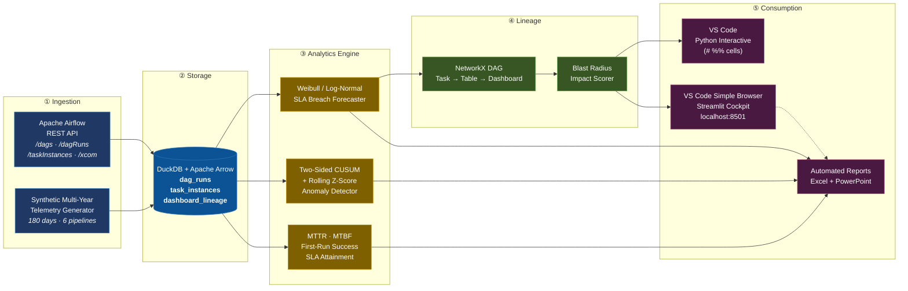

# PipelineSLA-Telemetry

**Upstream Data Pipeline Health &amp; Downstream Business Impact Forecaster**

Bridging the gap between Data Engineering ETL stability (Airflow / dbt) and Data
Analytics morning dashboard SLAs (Power BI / Tableau / Executive reporting).

[](.gitlab-ci.yml)
[](pyproject.toml)
[](https://duckdb.org)
[](coverage.xml)
[](LICENSE)
[](Dockerfile)

---

## Context &amp; Motivation

Every large enterprise runs on a quiet contract between two teams that rarely
speak to each other before 07:00.

**Data Engineering** owns the upstream ETL estate — the Airflow DAGs and dbt
models that move 400 million rows a night. Their success metric is *task-level
stability*: did the job exit `0`? **Data Analytics** owns the downstream
dashboards — the CFO close cockpit, the revenue pulse, the credit-risk board
pack. Their success metric is *business-level freshness*: is the number on the
screen correct, and was it there when the executive opened it?

The failure mode lives in the gap between those two metrics, and it is always
the same shape:

> **A task succeeds technically while failing materially.**
> The upstream extract returns zero rows. The load job writes an empty partition
> and exits `0`. Airflow paints the DAG green. The dashboard refreshes on
> schedule — with stale data, or a flat line. Nobody notices until a business
> user escalates at 09:15, and by then the morning meeting has already happened.

Classical monitoring cannot catch this, because nothing technically failed.
Green dashboards of green tasks hide the problem.

PipelineSLA-Telemetry closes the gap with three capabilities that operate
*before* the executive opens the dashboard:

1. **Probabilistic runtime forecasting.** While an overnight job is still
   running, a Weibull / Log-Normal model fitted to that task's own history
   returns the exact probability that it will breach the morning SLA — not a
   binary "still running" status, but a calibrated number an operator can act on
   at 06:40.
2. **Statistical drift detection.** A two-sided CUSUM and rolling z-score engine
   watches *loaded row counts*, not exit codes, and catches the silent zero-row
   ingestion failure the moment it becomes a sustained deviation from the
   seasonal baseline.
3. **Blast radius lineage.** A NetworkX dependency graph maps every upstream
   task to the client-facing dashboards it ultimately refreshes, weighted by
   business criticality and audience size — so a stall is triaged by *business
   impact*, not by the alphabetical order of DAG names.

The result: fewer morning surprises, and an operations standup driven by
evidence instead of anecdote.

---

## Architecture Pipeline Diagram



---

## Mathematical Rigor

### 1. Weibull duration model &amp; survival probability

Task runtimes are strictly positive and right-skewed: most runs finish near the
median, while a minority drag on for hours because of lock contention, retry
storms or month-end volume surges. A Normal fit underestimates that tail
catastrophically.

The **Weibull** distribution models this with a shape parameter $$k$$ that also
encodes the hazard regime ($$k<1$$ infant mortality, $$k=1$$ memoryless,
$$k>1$$ wear-out):

$$
f(t;\lambda,k) = \frac{k}{\lambda}\left(\frac{t}{\lambda}\right)^{k-1} e^{-(t/\lambda)^k},
\qquad t \ge 0,\; \lambda>0,\; k>0
$$

The **survival function** — the probability the run is still executing after
$$t$$ — is:

$$
S(t) = P(T > t) = e^{-(t/\lambda)^k}
$$

Parameters are estimated by maximum likelihood (SciPy `weibull_min.fit` with
`floc=0`), and the **Log-Normal** alternative

$$
f(t;\mu,\sigma) = \frac{1}{t\sigma\sqrt{2\pi}}\exp\!\left(-\frac{(\ln t-\mu)^2}{2\sigma^2}\right)
$$

is fitted in parallel. The two are compared by **Akaike Information Criterion**,
$$\mathrm{AIC} = 2p - 2\ln \hat{L}$$, and the lower-AIC model drives the
forecast.

**Breach probability for an in-flight run.** Let $$e$$ be the elapsed runtime
and $$c$$ the SLA cutoff. Given the run has already survived to $$e$$, the
correct posterior probability of breaching is the *conditional* survival:

$$
P(\text{breach} \mid T > e) \;=\; \frac{P(T > c)}{P(T > e)} \;=\; \frac{S(c)}{S(e)}
$$

and the expected additional runtime is the conditional mean

$$
\mathbb{E}[T - e \mid T > e] \;=\; \int_{e}^{\infty} \frac{S(u)}{S(e)}\,\mathrm{d}u
$$

Rolling completion boundaries — the P50 / P85 / P95 quantiles,
$$t_q = S^{-1}(1-q) = \lambda\,(-\ln(1-q))^{1/k}$$ — give operations a set of
escalation tripwires rather than a single deadline.

### 2. Two-Sided CUSUM for silent volume drops

Let $$x_i$$ be the row count loaded on day $$i$$, and let $$\mu,\sigma$$ be the
seasonal baseline mean and standard deviation. Standardise to
$$z_i = (x_i-\mu)/\sigma$$ and maintain two one-sided cumulative sums:

$$
S^{+}_i = \max\!\left(0,\; S^{+}_{i-1} + z_i - k\right)
\qquad\text{(upward shift)}
$$

$$
S^{-}_i = \max\!\left(0,\; S^{-}_{i-1} - z_i - k\right)
\qquad\text{(downward shift — the silent drop)}
$$

An alarm fires when either statistic crosses the decision threshold
$$\max(S^{+}_i, S^{-}_i) > h$$. Here $$k$$ is the reference slack (half the shift
size you want to detect, in sigma) and $$h$$ the decision interval; both are
configurable in `config/config.yaml` under `detection.cusum`.

The power of CUSUM is that it integrates *small persistent* deviations: a
sustained 15% throughput loss that never trips a point-wise threshold will still
drive $$S^{-}$$ above $$h$$ within a few days. It is complemented by a **rolling
z-score**

$$
z_i^{\text{roll}} = \frac{x_i - \overline{x}_{i-w:i}}{\mathrm{sd}_{w}(x_{i-w:i})}
$$

which reacts instantly to a single catastrophic observation. A run that reports
`state='success'` while loading fewer than `empty_run_ratio` (default 5%) of its
seasonal median is flagged `CRITICAL` as a **silent empty run**.

### 3. Downstream Blast Radius Index

For a stalled node $$n$$, let $$\mathcal{D}(n)$$ be the set of BI dashboards
reachable downstream of $$n$$ in the lineage DAG. Then:

$$
\text{BlastRadius}(n) \;=\; \sum_{d \in \mathcal{D}(n)}
\text{TierWeight}(d)\;\times\;\text{AudienceScale}(d)\;\times\;\frac{1}{\text{Depth}(n,d)}
$$

where **TierWeight** encodes mission criticality (TIER_1 = 5.0 … TIER_4 = 0.75),
**AudienceScale** encodes how many and how senior the consumers are
(BOARD = 10,000 … ANALYST = 50), and **Depth** is the shortest dependency hop
count from $$n$$ to $$d$$. Distance discounts impact: a task feeding a dashboard
directly (depth 1) hits harder than one mediated by three staging tables.

The score is bucketed into escalation tiers:

| Score | Category | Operational response |
|---|---|---|
| `< 5,000` | `LOW` | Log for the weekly review |
| `5,000 – 24,999` | `ELEVATED` | Page the on-call data engineer |
| `≥ 25,000` | `CRITICAL BUSINESS ESCALATION` | Wake the data platform lead; pre-draft the executive comms |

---

## VS Code Native Experience Guide

PipelineSLA-Telemetry is designed to be driven entirely from inside VS Code —
no separate BI tool, no context switching.

### 1. Python Interactive Window (`# %%` cells)

`scripts/interactive_analysis.py` is authored as a set of **`# %%` cells**. Open
it in VS Code and click **"Run Cell"** above any cell — output renders in the
native **Python Interactive** pane.

```
scripts/interactive_analysis.py
 ├─ # %% Cell 1  Bootstrap: connect to the DuckDB warehouse
 ├─ # %% Cell 2  Estate reliability scorecard (filterable DataFrame)
 ├─ # %% Cell 3  Weibull fit for gl_financial_reconciliation
 ├─ # %% Cell 4  Interactive Weibull survival curve + breach probability
 ├─ # %% Cell 5  Two-Sided CUSUM — silent zero-row ingestion hunt
 ├─ # %% Cell 6  Volume anomaly overlay (actual vs expected)
 ├─ # %% Cell 7  Downstream blast radius
 ├─ # %% Cell 8  Estate-wide blast radius ranking
 └─ # %% Cell 9  Headless figure export
```

Keyboard shortcut: **`Shift+Enter`** runs the current cell and advances.
The same file also runs headlessly (`python scripts/interactive_analysis.py`),
writing the Plotly figures to `reports/interactive/*.html`.

### 2. Streamlit cockpit in the Simple Browser

Launch the dashboard, then embed it in the editor:

```bash
streamlit run src/pipeline_sla/dashboard/app.py --server.port 8501
```

In VS Code: **`Cmd/Ctrl+Shift+P` → `Simple Browser: Show` → `http://localhost:8501`**.

The cockpit opens as an editor tab and offers four panes:

* **Morning Dispatch Radar** — live countdown to the 07:00 SLA cutoff with
  colour-coded pipeline progress bars (green on track, amber at risk, red
  breached).
* **Lineage Impact Explorer** — an interactive NetworkX map that glows red
  downstream when you simulate a stall on any task.
* **Volume Anomaly Inspector** — actual vs expected ingestion with CUSUM alarm
  markers.
* **SLA Breach Forecaster** — move the elapsed-time slider and watch the
  breach probability update live.

### 3. Excel Viewer extension

Generated workbooks are plain `.xlsx`, so the **Excel Viewer** extension renders
them read-only inside VS Code with conditional-formatting heatmaps intact:

```bash
pipeline-sla export --excel
# then right-click examples/sample_weekly_health.xlsx → "Open Preview"
```

---

## Quickstart

```bash
# 1. Install (editable, with dev tooling)
pip install -e .

# 2. Seed the warehouse with 180 days of synthetic enterprise telemetry
python scripts/generate_pipeline_runs.py --days 180

# 3. Run the full analytics sweep (KPIs, drift, forecasts)
pipeline-sla analyze --all

# 4. Produce the automated Excel ledger and PowerPoint review
pipeline-sla export --excel --pptx

# 5. Launch the visual management cockpit
streamlit run src/pipeline_sla/dashboard/app.py
```

Additional entry points:

```bash
pipeline-sla forecast --dag gl_financial_reconciliation \
                      --task reconcile_subledgers \
                      --elapsed 900 --cutoff 22

pipeline-sla lineage --task load_sales_fact
pipeline-sla dashboard --port 8501
pytest -q --cov=pipeline_sla --cov-report=term-missing
```

### Connecting to a real Airflow instance

Point the client at your webserver by setting the environment variables
referenced in `config/config.yaml`:

```bash
export AIRFLOW_BASE_URL="https://airflow.internal.example.com"
export AIRFLOW_API_TOKEN="<your-token>"
```

```python
from pipeline_sla.client import AirflowRestClient
from pipeline_sla.storage import TelemetryWarehouse

with AirflowRestClient.from_settings() as client:
    runs, tasks = client.extract_dag_history(["sales_ingestion_etl", "gl_financial_reconciliation"])

with TelemetryWarehouse("data/telemetry.duckdb") as warehouse:
    warehouse.insert_dag_runs(runs)
    warehouse.insert_task_instances(tasks)
```

---

## Docker Instructions

One command brings up the whole stack — the warehouse is seeded, the analytics
and reports are generated, then the cockpit is served on port 8501:

```bash
docker-compose up --build
```

* Cockpit → <http://localhost:8501> (also embeddable in the VS Code Simple Browser)
* Reports → written to the `pipeline_reports` volume
* Warehouse → persisted in the `pipeline_data` volume

Standalone image:

```bash
docker build -t pipeline-sla-telemetry:1.0.0 .
docker run --rm -p 8501:8501 pipeline-sla-telemetry:1.0.0
```

---

## Project Layout

```
pipeline-sla-telemetry/
├── config/                 # thresholds, pipeline estate, dashboard lineage
├── docs/screenshots/       # VS Code-styled SVG visual assets
├── notebooks/              # pipeline_audit_walkthrough.ipynb
├── scripts/                # generator, interactive analysis, screenshots, git history
├── src/pipeline_sla/
│   ├── client/             # Airflow REST client + synthetic telemetry generator
│   ├── storage/            # DuckDB + Arrow warehouse and schema
│   ├── analytics/          # metrics, Weibull forecaster, CUSUM detector
│   ├── lineage/            # NetworkX DAG graph + blast radius scorer
│   ├── reporting/          # Excel ledger + PowerPoint operations review
│   ├── dashboard/          # Streamlit cockpit (VS Code Simple Browser ready)
│   └── cli.py              # `pipeline-sla` command line
├── tests/                  # pytest suite (>88% coverage)
└── examples/               # verified sample .xlsx and .pptx artefacts
```

---

## Configuration Reference

| File | Purpose |
|---|---|
| `config/config.yaml` | Airflow connection, SLA cutoff, forecast/detection thresholds, escalation tiers |
| `config/pipelines.yaml` | The six-pipeline estate: schedules, baselines, failure modes |
| `config/dashboards_lineage.yaml` | BI dashboards and the upstream tasks that feed them |

Every threshold is externalised so operations can tune sensitivity without a
code change. Secrets are read from environment variables (`${AIRFLOW_API_TOKEN}`)
and never committed.

---

## Licence

Released under the [MIT License](LICENSE).

**Author:** Vinothkumar N · `vinothofficial14@gmail.com`
